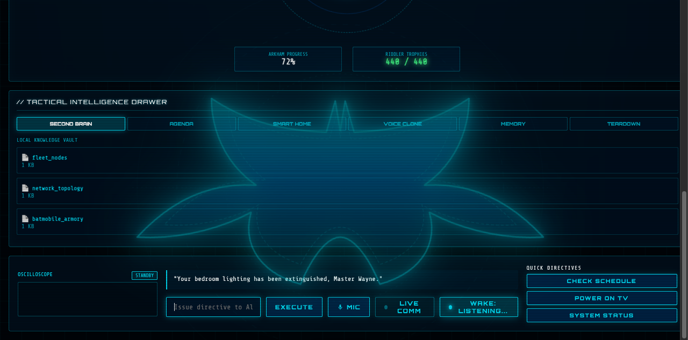

# Alfred Batcomputer: Cybernetic Voice Butler & Tactical HUD

An end-to-end, high-intelligence tactical AI butler system and sci-fi Batcomputer HUD designed for Wayne Enterprises tactical operations and smart-home command. Inspired by Zubair Trabzada's Jarvis architecture and Arkham Tech styling.



## Core Capabilities

- **Arkham Cybernetic HUD:** High-density neon cyan GUI featuring live Apple Silicon telemetry gauges, Web Audio oscilloscope visualizer, CRT scanlines, and centered glowing Arkham Bat-insignia watermark.
- **Always-On Hands-Free Wake Word (`"Alfred"`):** Passive in-browser speech recognition engine. Say *"Alfred, turn off my lights"* or *"Hey Alfred, status report"* to trigger instant command execution.
- **Dual Voice Architecture:**
  - **Michael Caine (Zero-Shot Neural Clone):** VoiceStudio diffusion voice model trained on *The Dark Knight* audio profiles.
  - **Daniel (Native macOS British Butler):** Sub-second (0.4s) high-speed voice engine for instant interactive conversation.
- **Dual-Tier Brain Routing:**
  - **OmniRoute Frontier Gateway:** High-intelligence routing (`antigravity/gemini-3-flash`, `antigravity/gemini-3.5-flash-lite`, `alfred-antigravity`).
  - **Local Ollama Daemon:** Air-gapped fallback running `qwen2.5:7b`.
- **Integrated Smart Home Control:** Native Home Assistant integration with proactive intent dispatching:
  - Smart Lights (JM Bedroom Dimmer, Living Room, Home Theater, All Quarters).
  - Sony BRAVIA XR-85X90L 4K TV power and status control.
  - Server Room Climate & Thermostat telemetry.
- **Dual-Tier Memory Vault:**
  - Dynamic 8-turn rolling conversational context buffer (`chat_history.json`).
  - Persistent factual memory bank (`memory.json`) with voice-directive auto-learning (*"Alfred, remember that..."*).
- **Tactical Calendar & ICS Ingestion:** Real-time agenda parser and `.ics` file synchronizer.
- **Website Teardown Tool:** Live reverse-engineering engine for extracting web architectures, tech stacks, and styles.

## System Topology & Ports

| Port | Service | Role |
| :--- | :--- | :--- |
| `7776` | FastAPI Backend | Python REST API, LLM Brain Dispatch, TTS/STT Orchestration |
| `7777` | Node.js Gateway Proxy | Dual HTTPS (Tailscale TLS) & LAN HTTP Reverse Proxy |
| `3900` | VoiceStudio Backend | Local faster-whisper ASR & Kokoro / Neural Voice Engine |
| `11434`| Ollama Daemon | Local LLM Inference (`qwen2.5:7b`) |
| `20128`| OmniRoute Gateway | Hosted Frontier Model Proxy |

## Deployment & Running

```bash
# 1. Start FastAPI Backend (Port 7776)
python3 server.py

# 2. Start Dual HTTPS/HTTP Gateway Proxy (Port 7777)
node proxy.js
```
